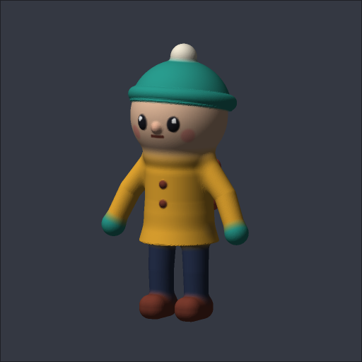
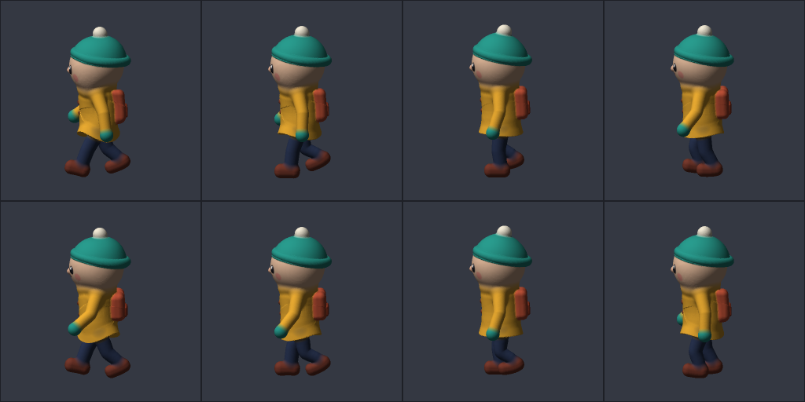

<p align="center"></p>

<h1 align="center">rig-worker</h1>

<p align="center"><b>Headless 3D modelling and rigging for AI agents, as an MCP server in one Cloudflare Worker.</b><br>
<a href="https://epinnock.github.io/rig-worker/">Docs and live playground</a> ·
<a href="#use-the-public-demo">Public demo MCP</a> ·
<a href="#self-host">Self-host</a></p>

An agent describes a character as simple shapes and gets back one closed, vertex-coloured mesh. It then places bones, binds them with automatic (bone-heat) weights, keys an animation, and checks every step with rendered pictures and numbers. Everything runs as plain JavaScript inside a Worker: no Blender, no GPU, nothing to install.

<p align="center"></p>

## What it does

| Step | Tool | |
|---|---|---|
| Model | `model`, `get_model` | Signed-distance shapes (sphere, ellipsoid, box, cylinder, cone, torus, capsule, tube, lathe, group) with smooth unions, cuts and paint → one watertight mesh. The model JSON is stored in the GLB, so refinements are small patches. |
| Look | `inspect`, `preview` | Bounds and cross-section slices; PNG views shaded, by dominant bone or by one bone's weight, with skeleton overlays, poses and animation frames. |
| Rig | `bind`, `get_skeleton`, `paint_weights` | Bone heat (Baran & Popović 2007, the method behind Blender's *Automatic Weights*) solved on a closed voxel proxy, so broken or many-piece meshes still bind. Local weight fixes by sphere or box. |
| Animate | `animate`, `qa` | Keyframed clips in Euler degrees; QA reports floor sinking, stretched or squashed edges, and hotspots with a ready-made repair region. |
| Files | `list_files`, `delete_file`, `import_url`, `export` | GLBs in R2; signed download links. |

On a test creature mesh, the dominant bone of 97.6% of vertices matches Blender 4.5's Automatic Weights with the same skeleton. In one test an agent (Claude Opus 5.5) modelled a 44-shape toy character, rigged it with 19 bones and made it walk. It took 14 minutes and cost $2.59 in API calls plus about a cent of Worker CPU.

## Use the public demo

The demo needs no token. It allows 30 requests a minute, of which 6 can be `model`/`bind` calls. Files are kept per client and deleted after a day.

```sh
claude mcp add --transport http rig-worker https://rig-worker-demo.epinnock.workers.dev/mcp
```

Other MCP clients use `{"type": "http", "url": "https://rig-worker-demo.epinnock.workers.dev/mcp"}`. Then ask your agent something like *"Use rig-worker to model a small toy robot, rig it and make it wave. Show me the pictures."*

To run the whole example pipeline from a terminal (model → skeleton → bind → paint → walk → qa → export):

```sh
git clone https://github.com/epinnock/rig-worker && cd rig-worker && npm install
node examples/pip/run.mjs        # pictures and pip_rig.glb land in out/pip
```

## Self-host

[](https://deploy.workers.cloudflare.com/?url=https://github.com/epinnock/rig-worker)

You need the Workers Paid plan, because a bind on a large mesh can use up to a minute of CPU. Deploying creates the R2 bucket. Set `RIG_TOKEN` to a long random string. Clients send it as `Authorization: Bearer <RIG_TOKEN>`, and it also signs download links.

```sh
npm install
npx wrangler deploy
openssl rand -hex 32 | npx wrangler secret put RIG_TOKEN
claude mcp add --transport http rig-worker https://rig-worker.<you>.workers.dev/mcp \
  --header "Authorization: Bearer <RIG_TOKEN>"
```

Besides `POST /mcp` there is a plain HTTP API: `PUT/GET/DELETE /files/<name>`, `GET /files`, `GET /dl/<name>?exp&sig` and `POST /bind` (multipart). The public demo is the same code deployed with `npx wrangler deploy --env demo`; see `wrangler.jsonc`.

## Develop

```sh
cp .dev.vars.example .dev.vars   # put a token in it
npm run dev                      # wrangler dev on :8799 with local R2
npm test                         # model -> bind -> paint -> animate -> qa in Node, ~15 s, no network
```

| File | |
|---|---|
| `src/worker.js` | routes, auth, demo rate limits and per-client file space |
| `src/mcp.js` | MCP JSON-RPC, tool schemas and descriptions |
| `src/sdf.js` | shapes → signed distance field → sparse surface nets mesh |
| `src/heat.js` | voxel proxy and bone-heat solve |
| `src/tools.js` | inspect, bind, paint, animate, qa, model |
| `src/render.js` | software rasterizer for previews |
| `src/glb.js` | glTF read/write via [glTF Transform](https://gltf-transform.dev) |

**Conventions.** Coordinates are glTF metres: +Y up, +Z front, +X the character's left. Rotations are Euler degrees applied X, then Y, then Z. The [docs](https://epinnock.github.io/rig-worker/) have every shape, field and tool.

**Known gaps.** There is no smoothing operation for weights and no undo for paints. `qa` does not separate stretched edges from squashed ones. Rebuilding a model drops its rig, so you bind again. Meshes carry vertex colours only. Skinning is linear blend with 4 influences.

## License

[MIT](LICENSE) © 2026 Ejiro Pinnock
